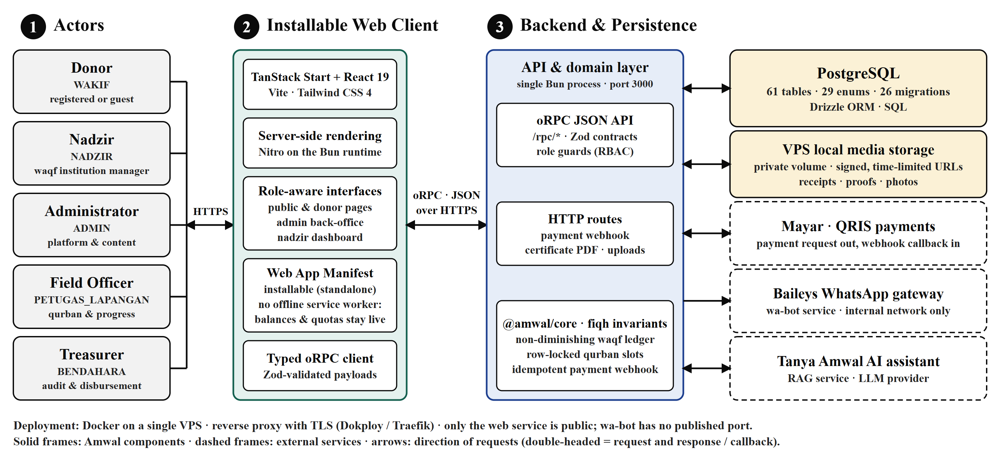
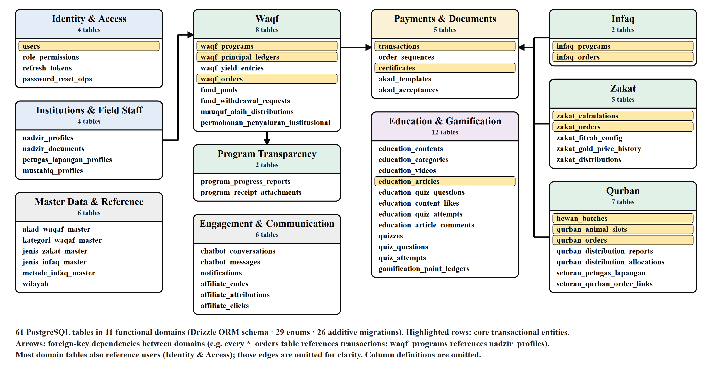
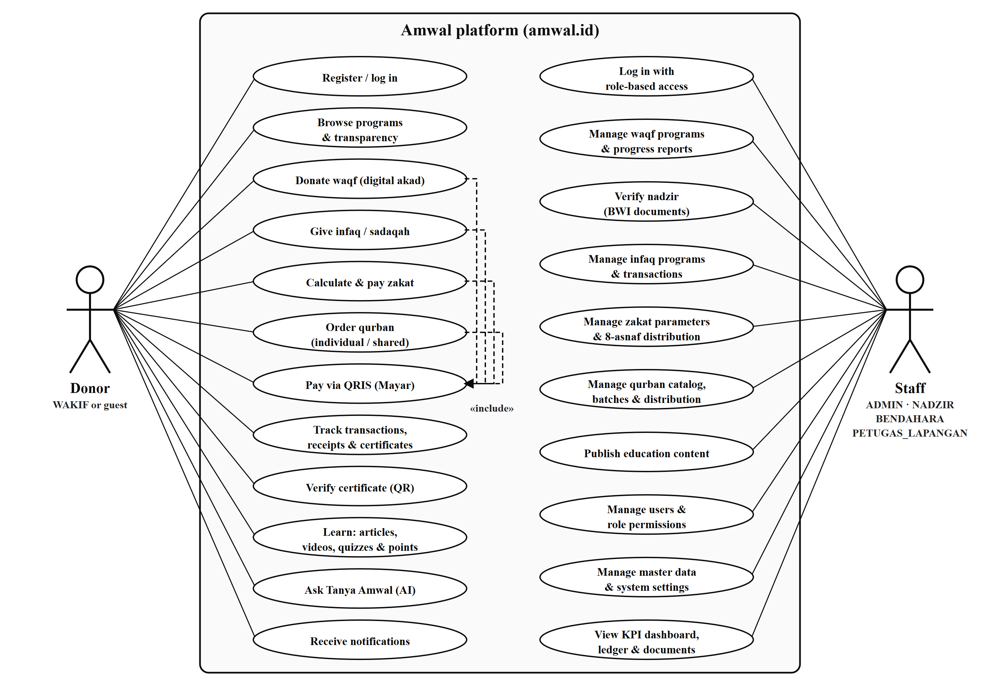

## Introduction #amwal-dev
Amwal stands for *Aplikasi Waqaf Aman Legal*. It is a web application that supports integrated ZISWAF (zakat, infaq, sadaqah, and waqf) and qurban management for donors and institutional administrators. It exists both as an interactive High-Fidelity (Hi-Fi) design and as a full-stack installable web application (Web App Manifest), live at [amwal.id](https://amwal.id). This repository accompanies the research paper **“A Design Thinking Approach to Enhancing Usability and Transparency in Digital Islamic Philanthropy Platforms”**. It is a research-artifact supplement (architecture, figures, interface evidence and evaluation data); the application source code is not part of this repository.

The platform was designed, implemented, and evaluated at the Manarul Ilmi Foundation (Yayasan Manarul Ilmi, YMI) and Masjid Manarul Ilmi, Institut Teknologi Sepuluh Nopember (ITS) in the period of May 2026 up until now (on-going). The process ran two user-side and two administrator-side usability evaluation cycles between 18 September and 16 October 2026.

## System Architecture



*Fig. S1. Block-flow architecture of the production system (`figures/figS1_system_architecture.png`).*

The system is organised in three numbered tiers:

1. **Actors.** Five role-based access control (RBAC) roles: donors (`WAKIF`, registered or guest checkout), `NADZIR` (waqf institution managers), `ADMIN`, `PETUGAS_LAPANGAN` (field officers) and `BENDAHARA` (treasurers). Feature permissions per role are stored in a configurable role–permission matrix.
2. **Installable web client.** A TanStack Start / React application with server-side rendering, role-aware interfaces (public and donor pages, an admin back-office and a nadzir dashboard) and a typed oRPC client. It is installable through a Web App Manifest (standalone display). It deliberately has **no offline service worker**, so that donation balances and qurban slot quotas are always read live from the server and never from a stale cache.
3. **Backend and persistence.** A single Bun process serves the oRPC JSON API (`/rpc/*`, Zod-validated contracts, role guards), a few raw HTTP routes (payment webhook, certificate PDF, uploads) and the shared domain kernel that enforces the fiqh and transactional invariants. State is kept in PostgreSQL and on private local media storage on the VPS. External services are Mayar (QRIS payments, with a webhook callback), a Baileys-based WhatsApp gateway that has no public port, and the "Tanya Amwal" AI assistant (a retrieval-augmented generation service, described in the companion chatbot paper, with an LLM provider fallback).

### Tech stack

| Layer | Technology |
|---|---|
| Runtime and framework | Bun 1.2, TanStack Start (React 19, Vite 7, Nitro SSR), Tailwind CSS 4 |
| API layer | oRPC + Zod 4, end-to-end type-safe (JSON over HTTPS) |
| Database | PostgreSQL, **61 tables**, 29 enums, 26 additive SQL migrations, Drizzle ORM |
| Access control | Role-Based Access Control (RBAC) with five roles; custom JWT sessions in `httpOnly` cookies |
| Delivery | Installable web application (Web App Manifest), without offline service worker |
| Payments | Mayar QRIS, idempotent webhook |
| Messaging | Baileys WhatsApp gateway (separate service, internal network only) |
| Storage | Private local media volume on the VPS, signed time-limited URLs |
| Deployment | Docker on a single VPS behind a TLS reverse proxy (Dokploy / Traefik) |
| Quality gates | 1,115 automated tests (370 domain-kernel, 745 application) and a type check across three workspaces |

### Data model



*Fig. S3. The 61 tables grouped into 11 functional domains (`figures/figS3_database_domains.png`).*

| Domain | Tables | Core entities |
|---|:-:|---|
| Identity & Access | 4 | `users`, `role_permissions` |
| Institutions & Field Staff | 4 | `nadzir_profiles`, `petugas_lapangan_profiles` |
| Waqf | 8 | `waqf_programs`, `waqf_principal_ledgers`, `waqf_orders` |
| Program Transparency | 2 | `program_progress_reports`, `program_receipt_attachments` |
| Infaq | 2 | `infaq_programs`, `infaq_orders` |
| Zakat | 5 | `zakat_calculations`, `zakat_orders` |
| Qurban | 7 | `hewan_batches`, `qurban_animal_slots`, `qurban_orders` |
| Payments & Documents | 5 | `transactions`, `certificates` |
| Education & Gamification | 12 | `education_articles`, `gamification_point_ledgers` |
| Engagement & Communication | 6 | `notifications`, `chatbot_conversations` |
| Master Data & Reference | 6 | `akad_waqaf_master`, `wilayah` |

### Use cases



*Fig. S2. Main use cases of donors and staff roles (`figures/figS2_use_case.png`).*

## Key Features

**Transactional integrity and fiqh compliance**
- Non-diminishing principal ledger for cash waqf, so the waqf principal is never spent.
- Pessimistic row-level locking for collective qurban slot allocation, preventing double booking of shared animals.
- Idempotent (duplicate-safe) payment webhooks, so repeated gateway callbacks never record a payment twice (a payment is recorded exactly once even if the gateway sends the same notification several times).
- SHA-256 hash-verified PDF waqf e-Certificates.
- Gold-price edit feature for zakat nisab calculation.
- Document-assisted nadzir verification: a nadzir must attach an official certificate from Badan Wakaf Indonesia (BWI) showing that they are a registered nadzir.

**Dual-perspective interface (Donor and Administrator)**
- Cross-contract philanthropic services (zakat, infaq, sadaqah, waqf, qurban) in one platform.
- Real-time receipt transparency.
- RFM-D donor analytics for administrators.
- Interactive Sharia education.

## Methodology

The work combines two approaches in a hybrid, two-phase process:

1. **Design Thinking** for problem exploration and interface design: empathize, define, ideate and prototype with donors and YMI administrators, producing the empathy map, affinity diagram, wireframes and the Hi-Fi prototype (Figma) (Figs. 1–5 and 7–8).
2. **Extreme Programming (XP) with rapid weekly iteration** for implementation: findings of every usability evaluation cycle were triaged into *must fix*, *polish* and *deferred* groups and implemented in small weekly increments, each validated by the automated test suite (1,115 tests) and the type check before release.
3. **Evaluation** of each cycle through User Acceptance Testing (UAT) with the Single Ease Question (SEQ, 1–7), the System Usability Scale (SUS, 0–100), task success and indicative task completion duration.

Timeline. The implementation repository was initialised in August 2025; the greenfield TanStack Start / Drizzle implementation described here began in early September 2026, and the four usability evaluation cycles took place between 18 September and 16 October 2026 (UAT #1–#4). The mapping from UAT findings to implemented changes is documented in [`evaluation/iteration_log.md`](evaluation/iteration_log.md).

## Repository Structure

```text
amwaldev/
├── figures/
│   ├── fig1–fig3, fig6 *.png      # Design Thinking figures and the architecture figure of the paper
│   ├── figS1–figS3 *.png          # Supplementary figures: architecture, use cases, database domains (300 DPI)
│   ├── src/                       # SVG sources of figS1–figS3 and the PNG render script
│   ├── wireframe/{donor,admin}/   # Wireframes (Figs. 4–5)
│   ├── prototype/{donor,admin}/   # Hi-Fi prototype screens (Figs. 7–8)
│   └── ui-screenshots/            # 2x screenshots of the implemented web application
├── evaluation/                    # UAT data (SEQ, SUS, task success, duration), iteration log
├── LICENSE
└── README.md                      # Project introduction
```

## Interface Evidence

- **Prototype and wireframes** designed by the UI/UX team: [`figures/wireframe/`](figures/wireframe) and [`figures/prototype/`](figures/prototype), each for the donor (desktop and mobile) and administrator perspectives.
- **Implemented web application**: [`figures/ui-screenshots/`](figures/ui-screenshots), captured at 2× pixel density with device emulation, from a build of 16 October 2026 with a seeded demonstration dataset (no real donor data). See the README in that folder.

## Contributions

1. A full-stack, type-safe installable web application architecture with software engineering safeguards for transactional integrity and fiqh compliance.
2. A dual-perspective interface design (Donor and Administrator) that unifies cross-contract philanthropic services, real-time receipt transparency, RFM-D donor analytics, and interactive Sharia education.
3. A controlled empirical evaluation of usability and task efficiency across four UAT cycles.

## Results

| Cycle | SEQ | SUS | Task success | Task completion duration (indicative) | Date and time of UAT | User demographic |
|---|:---:|:---:|:---:|:---:|---|---|
| User iteration 1 (UAT #1, prototype) | 5.17 / 7.00 | 65.83 | n/r | 105.36 s (01:45) | 18 September 2026, 13:00–15:00 WIB | 3 donors/users (2 female, 1 male; aged 21–27; Program Coordinator, Marketing, YMI Manager) |
| Admin iteration 1 (UAT #2, prototype) | 6.49 / 7.00 | 54.17 ᵃ | n/r | 134.00 s (02:14) | 25 September 2026, 13:00–15:00 WIB | 4 administrators/staff (2 female, 2 male; aged 21–25; Graphic Designer, Program Coordinator, Marketing, Video Editor) |
| User iteration 2 (UAT #3, implemented app) | 5.75 / 7.00 | 68.1 ᵇ | 89.9% (62/69) | 63.06 s (01:03) | 9 October 2026, 13:00–15:00 WIB | 4 donors/users (2 female, 2 male; aged 21–27; Graphic Designer, Program Coordinator, Content Strategist, Marketing); device not recorded in the UAT #3 test log |
| Admin iteration 2 (UAT #4, implemented app) | 6.71 / 7.00 | 65.0 raw / 66.7 adjusted ᶜ | 89.4% (110/123); 96.5% (110/114) functional ᵈ | 88.70 s (01:28) | 16 October 2026, 13:00–15:00 WIB | 6 administrators/staff (5 female, 1 male; aged 23–40 ᵉ; Graphic Designer, YMI Finance, Content Strategist, 2 Fundraisers, Video Editor) |

n/r: not reported. Per-respondent anonymized data and methodological notes: [`evaluation/`](evaluation).

- ᵃ SUS of UAT #2 is affected by a variation in the input scale used by the observer in one test session.
- ᵇ UAT #3 values (SEQ 5.75, SUS 68.1) are recomputed from the raw per-respondent log. The initial draft aggregate (SEQ 5.69, SUS 65.00) was an aggregation made before the raw-log audit.
- ᶜ UAT #4 raw SUS is 65.0; the adjusted score 66.7 corrects the reversed-scale scoring of item 6 for one respondent. The initial draft aggregate (SEQ 6.64, SUS 61.67) was an aggregation made before the raw-log audit.
- ᵈ Overall task success counts all 123 recorded task attempts; functional task success excludes 9 attempts at features that did not exist in the product at test time.
- ᵉ One respondent's age was recorded as a 30–40 band.
- Task completion duration is an *indicative* value: the format in which observers recorded time varied in the raw logs. Durations are reported as aggregated by the UI/UX team.

**Ethics.** All participants voluntarily participated in the moderated usability testing sessions and agreed to the anonymized use of their evaluation feedback for academic research.

## Related Work

- **Amwal Chatbot: Source-Grounded Retrieval-Augmented Generation for Enhancing Public Access to Indonesian Islamic Philanthropy Regulations.** Submitted to IEEE SOFTT 2026, Yogyakarta, Indonesia. Repository: [`amwal-chatbot`](https://github.com/irhafidz/amwal-chatbot).

## Acknowledgment

This research is funded by the Higher Education Technology and Innovation (HETI) Project ADB Loan 4110-INO under Contract Number 0008/01.PKS/PPK-HETI/ITS/2026. The authors gratefully acknowledge the cooperation of Yayasan Manarul Ilmi and Masjid Manarul Ilmi at Institut Teknologi Sepuluh Nopember for their support during the platform development.

## Disclaimer

Amwal is a research platform. Its zakat calculations and Sharia education content are informational and are not a substitute for an official fatwa.
